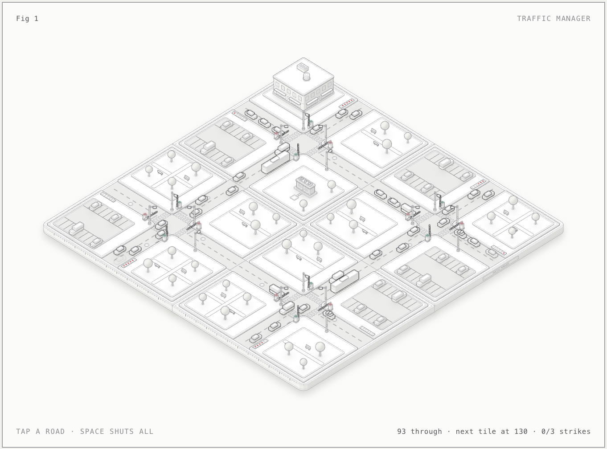

# Traffic Manager

A small physics game in the style of the [Anatomy](https://github.com/wheresryan22/anatomy) skill: model crossroads on base plates, drawn as crafted isometric SVG, where you run the boom gates and keep traffic moving without letting the roads meet. Get enough traffic through and another crossroads tile joins the board.



Open `game/traffic-manager.html` in a browser (or `game/traffic-manager-dark.html`). It is one standalone file with no dependencies.

## How to play

The board starts in a demo that runs a safe two-phase plan. Press **Space** or tap the board to start a shift. Every gate starts shut.

| Input | What it does |
|---|---|
| Tap or click a road | Swing the gate on that road open or shut |
| `Space` | Start a shift; during a shift, shut every gate |
| `P` | Pause |

Only the asphalt takes a tap: the gate cabinets, the junction box and the islands do nothing.

**Tiles.** The readout counts the vehicles you get through. At 15, 40, 80, 130, 190, 260, 340 and 430, a new crossroads joins the board: east, then south, then the corner that completes a 2×2, then out to 3×3 (nine tiles at most). Each new tile arrives with its gates shut, the view eases back to fit it, and where two tiles meet the road runs straight on, so traffic leaving one junction queues at the next.

**Strikes.** The shift ends at **3 strikes**, shown on the lamps of the signal controller.

- A crash is a strike.
- So is a jam. Once **6 vehicles** are queued off the board at an outer entry (its meter is full and pulses), a **5 s** countdown starts. Every vehicle that drives on from the queue winds it back to 5 s. If it runs out, that's a strike, and it starts again while the queue is still that long.

Demand rises through the shift and swings between the two roads every 80 s, so a fixed rhythm falls behind. A full lane takes about 4.5 s to start moving once its gate opens, so open a jammed road early.

## The physics

Everything the board shows comes from one pure model in `src/model.mjs`, in metres and seconds, stepped at 120 Hz.

- **Drivers** follow the [Intelligent Driver Model](https://en.wikipedia.org/wiki/Intelligent_driver_model): free-road acceleration `a·(1 − (v/v₀)⁴)` and a braking term from the gap to whatever is ahead. Cars, vans and buses have their own length, mass, acceleration, comfortable braking and headway.
- **Red lamp.** When a gate shuts, each driver asks whether they can stop a metre short of the line at 4 m/s² or less. Those who can, stop. Those who can't (the dilemma zone) run the line. Drivers coming onto the board at a red lamp have seen it on the way in, so they arrive slow enough to stop.
- **Lanes run through tiles.** Each row of tiles carries an eastbound and a westbound lane, and each column a southbound and a northbound one, with a stop line per tile. A driver watches only the next gate on their lane and decides afresh at each one.
- **The arm** has a detector: it won't come down while anything is under it, and it takes 1.4 s to swing.
- **Drivers trust the gates.** They follow the car ahead, brake for wrecks, and yield to a vehicle stopped across their path only after a 0.6 s reaction time and only if it arrived first. They don't watch the other road, so if you open both roads at once, they meet.
- **Crashes** are oriented-box collisions resolved with an impulse at the contact point: momentum is conserved, with restitution 0.15 and a friction impulse that sets the wrecks spinning. Wrecks slide on tyre friction (μ 0.7 sideways, 0.25 rolling), block the lane, then fade away 4 s after they stop.

`npm test` checks these: stopping distance and braking, the dilemma zone, the arm's detector and timing, momentum conservation, crashes and wrecks, queueing behind a wreck, a four-way standoff in the box clearing, jam strikes and their countdown, crashes and jams sharing the strikes, a car crossing into the next tile and stopping at its gate, vehicles holding still on the board as tiles are added, the growth order and thresholds, a crash-free safe plan on one tile and on 2×2, and determinism per seed (with tiles added along the way).

## Build

Requires Node 20.10 or later. There is nothing to install.

```sh
npm run build   # writes game/traffic-manager.html and game/traffic-manager-dark.html
npm test
```

In the page, `window.trafficManager` exposes the live game and the model, which helps when scripting a scene from the console. For example, `trafficManager.game().cleared = trafficManager.model.nextTileAt(trafficManager.game())` brings the next tile.

## Layout

| Path | What it is |
|---|---|
| `src/model.mjs` | The simulation: tiles, lanes, gates, drivers, collisions, demand, strikes, the demo autopilot. No DOM. |
| `src/parts.mjs` | Parts that move or are rebuilt live: vehicles, boom gates, the signal controller with its strike lamps. |
| `src/scene.mjs` | Each tile's static ground (plate, roads, islands and their plots, meters, shadows) and props, the camera framing for a set of tiles, and the painter's-order sort. |
| `src/live.js` | The page: game loop, input, tiles arriving, the camera, redraws and depth re-sorting. |
| `build.mjs` | Inlines the kit and modules into standalone pages, with the first frame pre-rendered: a static back SVG for the ground and a live front SVG for everything that moves. |
| `vendor/anatomy/kit/` | `iso-kit.mjs` and `lathe.mjs` from the Anatomy skill (MIT), unchanged. |
| `.claude/hooks/session-start.sh` | Installs the Anatomy skill into `~/.claude/skills` at the start of each Claude Code cloud session. |

## Ideas to take it further

- **Turning traffic.** Give some drivers a left or right turn through the box (an arc path instead of a straight lane), so a single open road can conflict with itself.
- **Pedestrians** on the crossings, released by tapping the crossing.
- **Emergency vehicles** that score double and can't be held for long.
- **Night shifts.** Use the skill's `kit/gl.mjs` to add lamp light and headlight cones as a WebGL layer in the same isometric camera.
- **Other tiles.** A T-junction or a roundabout tile in the mix, or a green-wave bonus for timing linked junctions.
